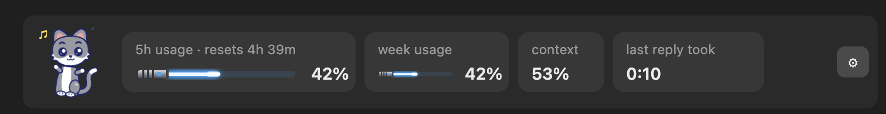

# catbar

A dancing cat and a usage meter that sit right above your Claude Code chat.



- **18 characters:** 8 cats (gray kitty, ginger, ghost, cool cat, black cat, siamese, white striped, orange in sunglasses), 9 space cats, and a songkok cat in baju Melayu
- **Moods:** chill, vibe, headbang, spin, shuffle, play with yarn, and nap. Pick one, or let it change on its own. Click the cat to switch.
- **Vibe:** Relaxed (slow, gentle), Normal, or Party
- **7 bar styles:** lightsaber (with color themes), paw prints, yarn ball, fish snacks, hearts, neon tube, rainbow trail
- **Live usage:** your 5-hour and weekly limits, reset countdown, context used, reply time, model, and a forecast of when you'll hit 100%
- **4 layouts:** stat tiles, one line, minimal, two rows. Simple or Detailed mode.
- **Red alert** at 90%. At 100% the cat naps and the bar turns into a lock with the time until your limit resets.
- **Smart alerts:** a notification at 75%, 90%, 100%, and when your limit resets
- **Today's stats** in the big cat pane: replies, tools, and peak usage

## Install

At the prompt of a Claude Code terminal session:

```
/plugin install catbar --marketplace booyen/claude-catbar
```

Answer `y` to add the marketplace, then press Enter to install for your user (every project).

From a shell:

```bash
claude plugin install catbar --marketplace booyen/claude-catbar
```

In the Claude desktop app: click **+** next to the prompt box, then **Plugins**, **Add marketplace** with `booyen/claude-catbar`, then **Add plugin**.

## Use

- The cat and the bar appear above the chat input in every session.
- Click **⚙** on the strip, or type `/cat-settings`, to change the character, mood, vibe, bar style, layout, and what the bar shows.
- `/cat` opens the big cat pane beside the chat. `/cat-band` hides or shows the strip.

## Privacy

catbar makes no network requests and sends nothing off your machine.

- **What it reads:** your plan's usage figures (5-hour and weekly limits, reset times), how full the chat context is, the session's cost and model name, and how many tools ran. All of it comes from Claude Code's own session figures (`$.session.usage()`, `$.session.model()`, and the `session.measure` and `tool.call` events). It never reads your messages, files, or credentials.
- **What it stores:** your settings, today's counts (replies, tools, peak usage), and the strip's width in columns, in Claude Code's plugin store on your machine (`$.store`).
- **What it sends:** only on-screen notifications. With Smart alerts on, it shows a notification through Claude Code (`$.ui.notify`, falling back to an in-app toast) at 75%, 90%, 100%, and when your limit resets. The notification goes to your own computer's notification center and nowhere else. Turn it off in settings under Alerts.

## Updating

When a new version is out:

```
/plugin marketplace update catbar
```

```
/plugin update catbar
```

Then start a new session. In the desktop app, use **+** → **Plugins** to update. See [CHANGELOG.md](CHANGELOG.md) for what changed.

## License

MIT
